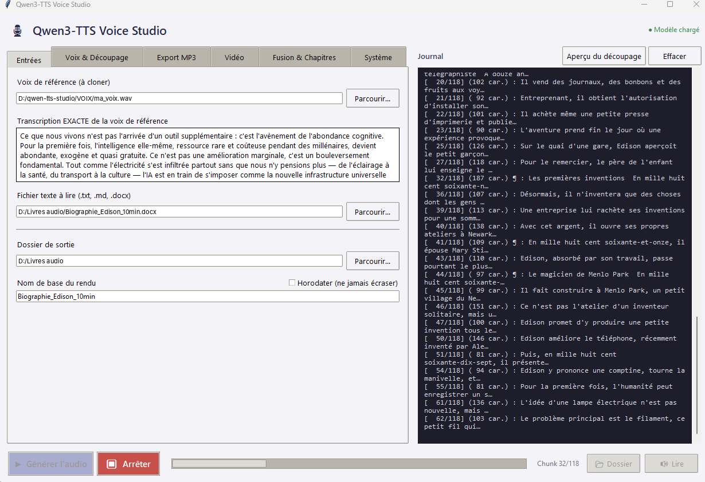

# 🎙️ Qwen3-TTS Voice Studio

**Transformez vos textes en livres audio, avec la voix de votre choix, sur votre propre ordinateur.**

**~20× plus rapide que Qwen3-TTS seul** · **100 % local** · **Installation en un double-clic**

Qwen3-TTS Voice Studio est une application de bureau libre qui lit vos documents Word, Markdown ou texte avec une voix clonée à partir d'un enregistrement de 10 à 30 secondes. Elle s'appuie sur [Qwen3-TTS](https://github.com/QwenLM/Qwen3-TTS), le modèle de synthèse vocale libre de l'équipe Qwen d'Alibaba, et le rend **environ 20 fois plus rapide** grâce à la génération par lots, aux CUDA Graphs et à un décodage économe en mémoire : sur une carte NVIDIA de 20 Go, **un texte de près de 10 minutes est lu en 1 min 18 s**.

Tout fonctionne **en local** : vos textes et vos voix ne quittent jamais votre machine. L'application gère aussi la suite de la production : export MP3, vidéo pour YouTube, fusion de chapitres et chapitrage automatique.

> ⚠️ **Ne clonez une voix qu'avec l'accord de la personne.** Imiter la voix de quelqu'un sans son consentement peut être illégal (droit à l'image et à la voix, usurpation d'identité) et nuire à cette personne. Utilisez votre propre voix ou une voix pour laquelle vous avez une autorisation écrite.

---

## Ce que fait l'application

- 🎙️ **Clonage vocal** : à partir d'un extrait de 10 à 30 secondes. Sa transcription peut être faite automatiquement par Whisper.
- 🎭 **Dialogues à plusieurs voix** : un paragraphe qui commence par `[Marie]` est lu avec la voix de Marie.
- 📄 **Lecture de documents** `.docx`, `.md` et `.txt`, avec nettoyage automatique : le Markdown, les emojis et les symboles sont retirés, les nombres et chiffres romains écrits en toutes lettres.
- ⚡ **Génération rapide** : environ **7 secondes d'audio par seconde de calcul** sur une carte graphique récente (voir [Performances](#performances)).
- 🎚️ **Exports** : WAV, MP3, rééchantillonnage en 44,1 ou 48 kHz.
- 🎬 **Vidéo** : une image fixe et la piste audio deviennent une vidéo MP4 prête pour YouTube.
- 🔎 **Contrôle qualité automatique** : Whisper réécoute chaque phrase générée et fait refaire celles qui ne correspondent pas au texte (mots sautés, répétitions).
- 📖 **Livre audio M4B** : un chapitre par titre du document Word, avec couverture, titre et auteur, lisible dans toutes les applications de livres audio.
- 💬 **Sous-titres** `.srt` synchronisés, et **correction** de quelques phrases sans relancer tout le rendu.
- 📚 **Fusion et chapitres** : assemblage de plusieurs fichiers audio (les chapitres d'un livre, par exemple), avec génération automatique du chapitrage YouTube et des chapitres intégrés au fichier.

## Ce qu'il vous faut

| | Minimum | Conseillé |
|---|---|---|
| Système | Windows 10 ou 11, 64 bits | |
| Carte graphique | NVIDIA, 8 Go de mémoire vidéo | NVIDIA, 16 Go ou plus |
| Pilote | NVIDIA récent (compatible CUDA 12.1) | |
| Espace disque | 15 Go (17 Go avec Whisper) | |
| Connexion Internet | pour l'installation et le premier téléchargement du modèle | |

Sans carte NVIDIA, l'application fonctionne, mais beaucoup trop lentement pour un usage réel.

## Installation en 3 étapes

1. **Téléchargez** ce dépôt (bouton vert *Code* → *Download ZIP*) et décompressez-le dans un dossier simple, par exemple `D:\qwen-tts-studio`. Évitez les dossiers synchronisés (OneDrive, Google Drive).
2. **Double-cliquez sur `installer.bat`**. Il installe Python 3.12 si besoin, crée l'environnement, télécharge PyTorch et les dépendances (environ 6 Go), vérifie ffmpeg et propose de télécharger le modèle (environ 4,5 Go). Comptez 10 à 30 minutes selon votre connexion.
3. **Double-cliquez sur `lancer_studio.bat`**.

Le détail de chaque étape et les solutions aux problèmes courants se trouvent dans le **[guide d'utilisation](docs/GUIDE.md)**.

## Premier rendu en 5 minutes

1. Onglet **Entrées** : choisissez votre **voix de référence** (un fichier WAV propre de 10 à 30 s), collez **sa transcription exacte**, puis choisissez le **texte à lire** et le **dossier de sortie**.
2. Cliquez sur **Aperçu du découpage** pour vérifier comment le texte sera lu.
3. Cliquez sur **▶ Générer l'audio**.

Au premier lancement, le chargement du modèle prend environ une minute. Les rendus suivants démarrent tout de suite.

## Performances

Mesures réalisées sur une NVIDIA RTX A4500 (20 Go), avec une voix de référence de 29 s accompagnée de sa transcription :

| Configuration | Audio produit par seconde de calcul | Mémoire vidéo |
|---|---|---|
| Qwen3-TTS d'origine, une phrase à la fois | 0,37 s | |
| Lots de 8 phrases, sans accélération | 1,25 s | 15 Go |
| Lots de 8 + accélération CUDA Graph | 3,4 s | 6 Go |
| Lots de 16 + accélération | 5,3 s | 7 Go |
| **Lots de 32 + accélération** (réglage par défaut) | **7,4 s** | **12 Go** |

En pratique, un texte de **9 min 40 s** est lu en **1 min 18 s**, soit environ **20 fois plus vite** que le code d'origine.

Le fonctionnement de ces optimisations est décrit dans [docs/ACCELERATION.md](docs/ACCELERATION.md).

## Contenu du dépôt

| Fichier | Rôle |
|---|---|
| `qwen_tts_studio.py` | l'application |
| `acceleration_qwen.py` | les optimisations de vitesse et de mémoire (chargé automatiquement) |
| `installer.bat` | installation complète |
| `lancer_studio.bat` | lancement de l'application |
| `diagnostic_vitesse.py` | mesure de la vitesse sur votre carte, pour régler la taille des lots |
| `diagnostic_vram.py` | mesure de la mémoire vidéo utilisée à chaque étape |
| `requirements*.txt` | versions exactes des paquets Python, testées ensemble |
| `docs/` | guide d'utilisation et notes techniques |

## Licence

Copyright 2026 Denis Favre. Distribué sous **licence Apache 2.0** : voir [LICENSE](LICENSE) et [NOTICE](NOTICE).

Vous pouvez utiliser, modifier et redistribuer ce logiciel, y compris à des fins commerciales, à condition de conserver la mention de copyright et la licence. Le logiciel est fourni « tel quel », sans garantie.

Qwen3-TTS (code et modèles) est publié par l'équipe Qwen d'Alibaba sous licence Apache 2.0. Il n'est pas inclus dans ce dépôt : il est téléchargé à l'installation.
